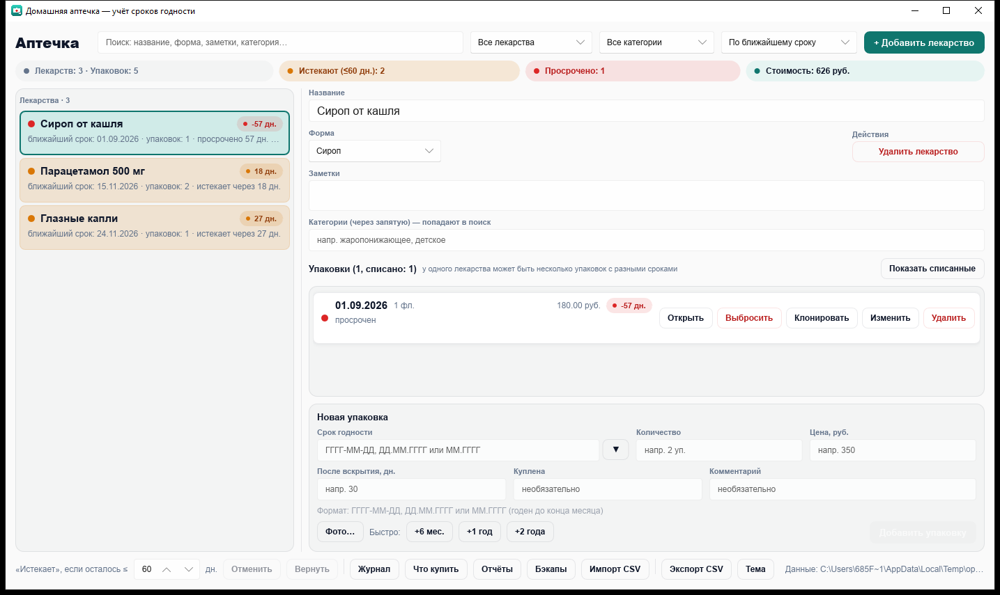

# Домашняя аптечка (apteka-tracker)

Небольшая Windows-программа на Rust для учёта лекарств домашней аптечки и их
сроков годности. Одиночный портативный `.exe`, данные хранятся рядом с программой.



## Возможности

- **Лекарства**: название, форма (таблетки, мазь, сироп, …), заметки.
- **Несколько упаковок у одного лекарства** — каждая со своим сроком годности,
  количеством, ценой и комментарием.
- **Жизненный цикл упаковки**: запечатана → кнопка «Открыть» (с периодом после
  вскрытия в днях — эффективная дата годности пересчитывается) → «Израсходовано»
  или «Выбросить» (списание: карточка гаснет, из активного учёта уходит, но
  остаётся в базе — видно по кнопке «Показать списанные», можно «Вернуть»).
- **Цены**: сводка «Стоимость» считает только активные упаковки.
- **Подсветка статусов** (от сегодняшней даты):
  - 🔴 красный — срок истёк;
  - 🟡 жёлтый — срок истекает в пределах порога (по умолчанию 60 дней, настраивается);
  - 🟢 зелёный — всё хорошо; серый — упаковок ещё нет.
- Лекарство в списке показывает **худший** статус своих упаковок и ближайший срок.
- Поиск по названию/форме/заметкам, фильтры «Все / Истекают / Просроченные»,
  сортировка по ближайшему сроку или по названию.
- Сводка сверху: всего лекарств, упаковок, сколько истекает и просрочено.
- Живая валидация даты в форме упаковки: сразу показывает, каким будет статус.
- Быстрый выбор срока: «+6 мес.», «+1 год», «+2 года». Кнопка «Клонировать» у
  упаковки копирует её количество/комментарий в форму новой упаковки
  (срок по умолчанию — сегодня + 1 год), удобно при покупке такой же пачки.
- Тёмная/светлая тема (кнопка «Тема»), экспорт CSV (открывается в Excel).
- **Журнал событий**: кнопка «Журнал» открывает окно с хронологией
  (добавления/изменения/открытия/списания; хранятся последние 400 событий).
- Автосохранение после каждого изменения.

## Горячие клавиши

| Клавиши | Действие |
|---|---|
| `↑` / `↓` | перемещение по списку лекарств |
| `Ctrl+N` | новое лекарство |
| `Ctrl+F` | перейти к поиску |
| `Ctrl+Z` | отменить последнее действие |
| `Ctrl+Y` (или `Ctrl+Shift+Z`) | вернуть отменённое |
| `Delete` | удалить выбранное лекарство (в два шага: «Точно удалить?») |
| `Esc` | отмена: сброс подтверждения удаления / редактирования упаковки |

Кнопки «Отменить» / «Вернуть» — в статусной строке внизу окна.

## Надёжность

- **Автобэкап**: при каждом запуске копия данных кладётся в `backups/`
  (рядом с exe), хранятся последние 5 копий.
- **Один экземпляр**: повторный запуск показывает сообщение «уже запущена» —
  два окна над одним файлом данных невозможны (файловый замок `apteka.lock`
  освобождается автоматически, в том числе после сбоя).
- **Пересчёт статусов**: раз в час подсветка обновляется по текущей дате,
  даже если приложение открыто через полночь.
- **Отмена/повтор**: до 50 шагов истории на сессию; правки одного поля
  (например, набор названия по буквам) склеиваются в один шаг.

## Сборка

Нужен Rust (https://rustup.rs). Затем:

```powershell
cargo build --release
```

Готовый файл: `target\release\apteka-tracker.exe`. Его можно скопировать в любую
папку и запускать — установка не требуется.

## Данные

- Файл данных: `apteka_data.json` — создаётся **рядом с exe** (портативный режим).
- Экспорт: `apteka_export.csv` — тоже рядом с exe (кнопка «Экспорт CSV»).
- Повреждённый файл данных не удаляется: переименовывается в
  `apteka_data.json.corrupt-<дата>` и программа стартует с пустой базой.

## Сроки годности «до месяца»

Производители часто указывают срок без дня: «Годен до 01 2028». Аптечная конвенция —
препарат годен **до конца** указанного месяца. В программе достаточно ввести
`01.2028` (или `2028-01`, `01/2028`, `01 2028`) — статус рассчитается до 31.01.2028
включительно, а в списке срок отобразится как `01.2028`. Полные даты
(`ГГГГ-ММ-ДД`, `ДД.ММ.ГГГГ`) считаются как обычно.

## Формат даты

В полях срока годности принимаются: `ГГГГ-ММ-ДД`, `ДД.ММ.ГГГГ` и `ММ.ГГГГ`
(месяц без дня — годен до конца месяца).

## Иконка

Иконка приложения генерируется скриптом
`crates/apteka-tracker/assets/make_icon.py` (нужен Python с Pillow:
`pip install pillow`). Запуск из папки `crates/apteka-tracker`:
`python assets/make_icon.py` → `assets/icon.png` (иконка окна)
и `assets/icon.ico` (встраивается в exe при сборке через `winresource`).

## Структура проекта

Cargo workspace: ядро (`apteka-core`) отделено от интерфейса (`apteka-tracker`).

```
apteka-tracker/                 # корень = workspace
├── Cargo.toml                  # workspace: members = crates/*
├── crates/
│   ├── apteka-core/            # ядро без UI: переиспользуемо, полно тестируемо
│   │   └── src/
│   │       ├── lib.rs          # модули + реэкспорт chrono
│   │       ├── model.rs        # доменная модель, статусы, даты + тесты
│   │       ├── storage.rs      # JSON, бэкапы, CSV + тесты
│   │       └── history.rs      # undo/redo на снимках + тесты
│   └── apteka-tracker/         # приложение (exe)
│       ├── build.rs            # slint-build + иконка в ресурсы exe
│       ├── assets/             # icon.png/ico, make_icon.py
│       ├── ui/app.slint        # интерфейс (Slint)
│       └── src/main.rs         # точка входа, State, связка колбэков
└── docs/screenshot.png
```

## Тесты

```powershell
cargo test
```
